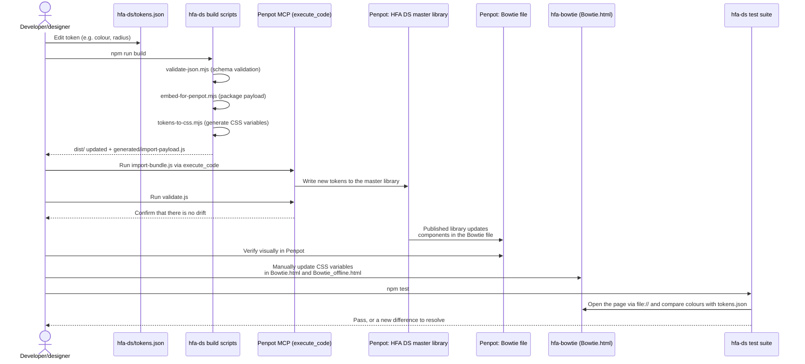
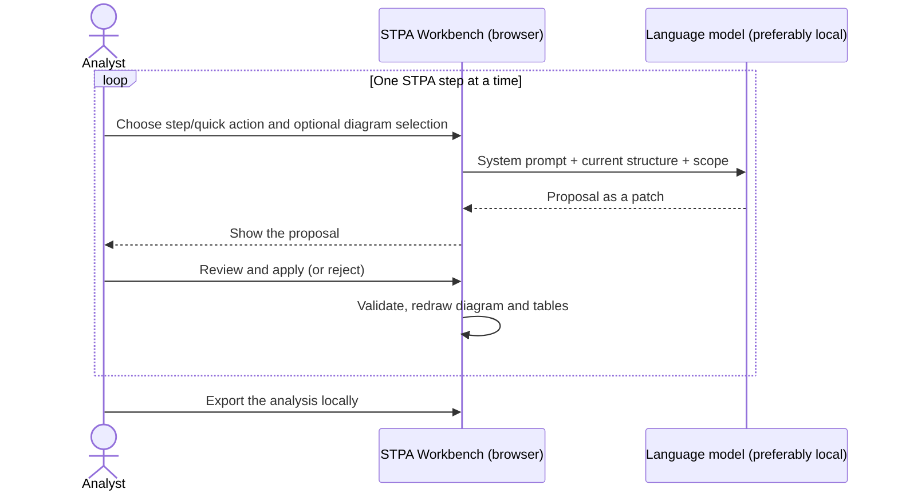

# Architecture: The HFA Family (hfa-ds, hfa-hta, hfa-bowtie, hfa-stpa, hfa-rbd)

> **Status:** All tools and their data models are under development. File formats and data structures may change without backward compatibility, and the tools should therefore not be used for production analyses.

## Live versions

| Tool | Live version | Status |
|---|---|---|
| HTA (Hierarchical Task Analysis + TTA) | [larswpettersson.github.io/hfa-hta/HTA.html](https://larswpettersson.github.io/hfa-hta/HTA.html) · [standalone offline file](https://larswpettersson.github.io/hfa-hta/hta_offline.html) | Runnable, under development |
| Bowtie | [larswpettersson.github.io/hfa-bowtie/Bowtie.html](https://larswpettersson.github.io/hfa-bowtie/Bowtie.html) · [standalone offline file](https://larswpettersson.github.io/hfa-bowtie/Bowtie_offline.html) | Runnable, under development |
| STPA Workbench | [larswpettersson.github.io/hfa-stpa/workbench/](https://larswpettersson.github.io/hfa-stpa/workbench/) | Runnable, under development; being adapted for cumulative, step-by-step AI-supported analysis |
| RBD (Reliability Block Diagram) | No live version – see the [hfa-rbd repository](https://github.com/larswpettersson/hfa-rbd) | Early design stage, not runnable |

The live versions are published through GitHub Pages. They are static pages without a back end: analysis data entered stays in the browser and leaves it only when the user exports it (see section 1).

Visual design decisions (typography, sizes, font stack) are documented in [docs/design-principles.md](docs/design-principles.md).

## 1. Rationale: Operation in Isolated Environments and Confidentiality

The architecture and design are based on two requirements:

1. **The tools must be easy to run in air-gapped environments and locally on corporate networks, without requiring any software installation.**
2. **The analyses performed must be able to remain confidential.**

These requirements drive the technical choices in every tool repository:

| Requirement | Architectural choice |
|---|---|
| No installation | Each tool is one or a few static HTML files with vanilla JavaScript and CSS. There is no build step, package manager, framework or server. A modern web browser is sufficient. |
| Operation without a network | The pages load no external resources (no CDN scripts, web fonts or API calls for core functionality). HTA and Bowtie are also available as a single self-contained file (`hta_offline.html`, `Bowtie_offline.html`) with the script inlined; the STPA Workbench is already a single file. The file can be transferred to an isolated environment and opened directly via `file://`. |
| Confidentiality | There is no back end and no database. The analysis state is held in browser memory and saved by exporting to a local JSON file that the user stores. `localStorage` is used only for preferences (theme, column selection, panel width, etc.). |
| Confidentiality with AI support | AI support in the STPA Workbench is optional; the editor, diagram and safety-case tables work without a language model. If a cloud provider (Claude, Gemini) is selected, the structure is sent to that provider. For confidential analyses, a locally hosted model (Ollama, LM Studio, LocalAI) should be used, in which case no data leaves the computer or the local network. |

This trade-off is deliberate: without build steps or package dependencies, design tokens are transferred manually to each tool's CSS (see section 4) and no code is shared between the tools. In return, each tool is self-contained, auditable and usable without involvement from the IT department.

## 2. Purpose and Structure

This document describes the architecture of five related repositories within the Human Factors Analysis (HFA) family:

- **hfa-ds** – Design system repository. Contains no runnable applications; it is the authoritative source for design tokens (colours, typography, radii, etc.), build scripts and Penpot sync tools that keep a central Penpot design library and the consumer projects' Penpot files synchronised. It also holds a shared test suite (Playwright) that runs against the tools in the sibling repositories. Runs on Node.js (ESM) with no runtime dependencies.
- **hfa-hta** – Standalone web tool for Hierarchical Task Analysis (HTA) combined with Tabular Task Analysis (TTA) and HEI fields. The main editor is `HTA.html`, with its logic in `scripts/hta-app.js`. Export to JSON and to CSV (for Excel and SmartArt), undo/redo, keyboard shortcuts and a help dialog. The data model is version 2.
- **hfa-bowtie** – Standalone web tool for drawing and editing bowtie diagrams (causes → top event → consequences, with preventive and recovery barriers). The logic lives in `scripts/bowtie-app.js`. The example data is based on a signal passed at danger (SPAD, Swedish OSPA) scenario. Printing scales the diagram to a single A4 landscape page. The data model is version 1.
- **hfa-stpa** – Support for System-Theoretic Process Analysis (STPA). Its core is the **STPA Workbench** (`workbench/index.html`), a single-file application with a JSON editor for the control structure, an automatically drawn SVG diagram, tables for losses, hazards, unsafe control actions (UCAs) and safety constraints, and an analysis chat with a language model of choice. The repository also contains `mermaid-stpa`, a separate Mermaid diagram plugin for STPA control structures (a TypeScript package with its own build step, not part of the Workbench runtime).
- **hfa-rbd** – Tool for Reliability Block Diagrams (RBD). It is at an **early design stage and is not runnable**. Its current content is a three-panel interface shell (library, canvas, analysis) with static sample content, `styles/rbd.css` and an initial `scripts/rbd-app.js`.

The shared purpose is to support safety and human factors analysis through separate, focused in-browser editors, while visual consistency (colours, fonts, component appearance) is maintained through a shared design system in Penpot, sourced from `hfa-ds`.

**Key architectural characteristic:** There is **no runtime code coupling** (no npm packages, no shared JS modules, no API calls) between the repositories. Coupling is indirect, via:

1. Penpot as a shared design tool – `hfa-ds` owns the master tokens and synchronises them to each consumer's Penpot file via MCP scripts.
2. Manually maintained design conventions – CSS variables in each HTML file that are meant to mirror `hfa-ds/tokens.json`.
3. The test suite in `hfa-ds` – it opens the tools' HTML files from the sibling repositories and checks that they load without errors and that their colours match `tokens.json`. This coupling concerns verification only, not runtime.

## 3. Status by Tool

| Tool | Entry point | Offline file | Data model | Persistence | Status |
|---|---|---|---|---|---|
| HTA | `HTA.html` (+ earlier `hta-editor2.html`, `hta-editor.html`) | `hta_offline.html` | JSON v2 (HTA tree + `ttaRecords`) | JSON export/import, CSV export | Runnable, under development |
| Bowtie | `Bowtie.html` | `Bowtie_offline.html` | JSON v1 | JSON export/import, print | Runnable, under development |
| STPA Workbench | `workbench/index.html` | Same file (single-file application) | JSON (losses, hazards, constraints, UCAs, control structure, actuators, sensors) | JSON export/import, chat export as Markdown | Runnable, under development; transition to cumulative analysis in progress |
| RBD | `RBD.html` | – | Draft | – | Early design stage, not runnable |

All data models are under development. Exported files may need to be converted or recreated when the models change.

## 4. Component Diagram – Communication Between Repositories

**Notes on the diagram:**

- `hfa-ds` is the only node with a build pipeline (validation → packaging → CSS generation) and the only one that communicates with Penpot MCP for synchronisation.
- Penpot acts as a hub: tokens flow in from `hfa-ds` and are published as component libraries to each consumer file (Bowtie, HTA, STPA, RBD).
- `hfa-hta`, `hfa-bowtie` and the STPA Workbench follow the same architectural pattern: one HTML page, a JavaScript part that owns all state in memory, and JSON-based import/export for persistence (no back end, no database).
- Dashed lines show manual or non-runtime couplings (design → code, test → tool, optional AI call), as opposed to the script-driven MCP flows.

## 5. Sequence Diagram – Token Sync from hfa-ds to a Consumer Tool

This is the primary architectural use case for the design system: a designer or developer changes a design token in `hfa-ds` and propagates the change to a consumer tool (e.g. `hfa-bowtie`).

**Note:** Because the tools have no build steps or package dependencies, the code step is manual. This is a deliberate trade-off to meet the requirements in section 1, not an incomplete integration. The test suite detects any drift that arises; known differences are listed in `knownDrift` in `tests/shared/tokens-sync.spec.mjs`.

## 6. STPA – Cumulative Analysis with Step-by-Step AI Support

The STPA Workbench is being adapted to carry out the analysis **cumulatively**: each STPA step builds on the results of the previous one, and AI supports the analyst one step at a time. The analyst stays in control: the AI proposes, and the analyst reviews and decides what enters the analysis.

Principles in the current version:

- **One shared model:** The whole analysis (losses, hazards, safety constraints, control structure, UCAs) is held in a single JSON structure that the editor, diagram and tables read from. Each step adds to or refines parts of the same model.
- **Changes as patches:** The language model is asked to return only what changes (`"patch": true`, with `remove` for deletions). The analyst explicitly chooses **Apply to editor**, and the change can be undone.
- **Scoping to a selection:** The analyst can select elements in the diagram so that a question focuses on them, while the whole structure is still sent as context.
- **Standalone questions:** By default, each question is sent with the structure and its scope but without the earlier chat history. This makes each step traceable to the current state of the model rather than to a long conversation.
- **Quick actions per analysis activity:** identify UCAs, loss scenarios, feedback latency, process-model flaws, suggested reconfiguration and safety constraints.

The transition to a fully step-by-step workflow is in progress, and the data model will change along with it.

## 7. Testing and Quality Assurance

- **Shared test suite in hfa-ds:** `npm test` runs Playwright against the tools in the sibling repositories (the location can be set with `HFA_WORKSPACE`). Pages are opened via `file://`, without a development server, which mirrors how the tools are used in isolated environments. `tests/shared/` runs against every tool in `tests/lib/tools.mjs` (clean load and colours matching `tokens.json`); tool-specific tests live in `tests/<tool>/` (currently STPA: selection, scope, conversions and patches). The GitHub Actions workflow `test-tools.yml` checks out all repositories side by side and runs the suite.
- **Per-tool smoke tests:** `hfa-hta` and `hfa-bowtie` have Python-based smoke tests (`scripts/*-smoke-test.py`).
- **Token validation:** `validate-tokens.yml` validates `tokens.json` in `hfa-ds`.
