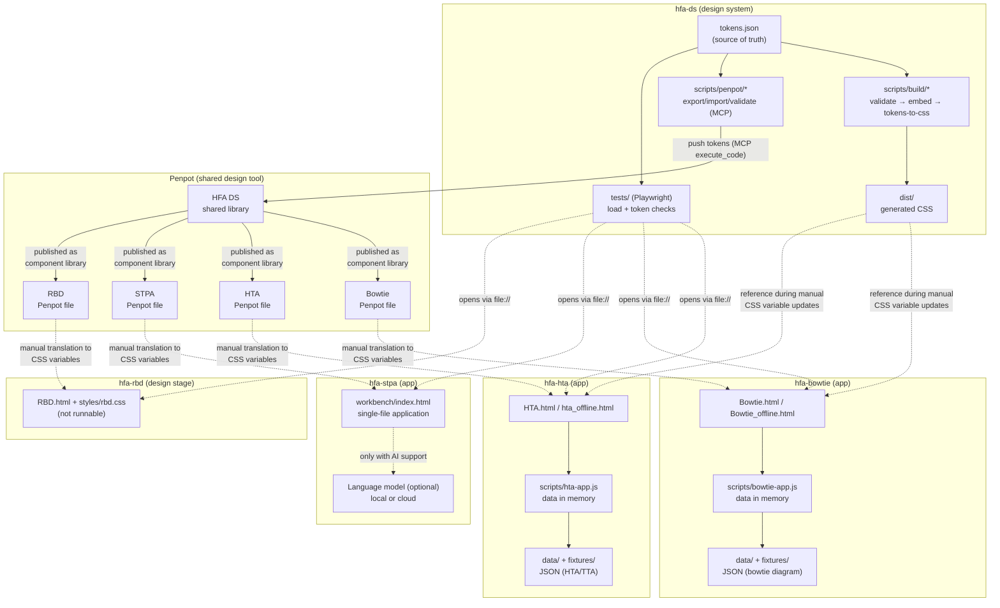
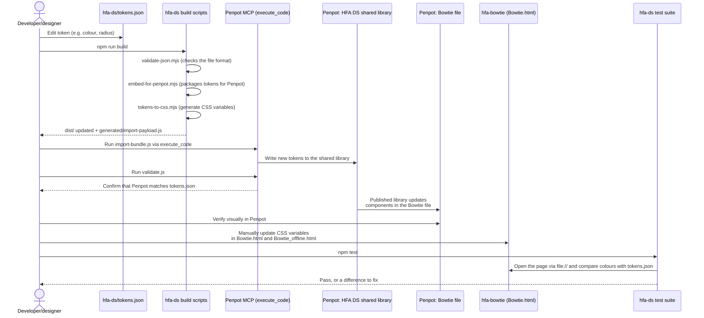
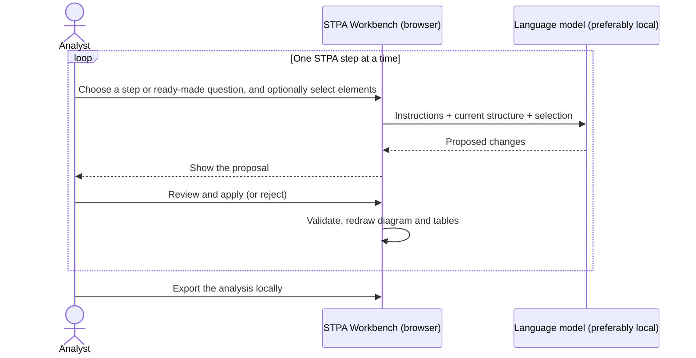

# Architecture: The HFA Family (hfa-ds, hfa-hta, hfa-bowtie, hfa-stpa, hfa-rbd)

> **Status:** All tools and their data models are under development. File formats and data structures may change without backward compatibility, and the tools should therefore not be used for production analyses.

## Live versions

| Tool | Live version | Status |
|---|---|---|
| HTA (Hierarchical Task Analysis + TTA) | [larswpettersson.github.io/hfa-hta/HTA.html](https://larswpettersson.github.io/hfa-hta/HTA.html) · [standalone offline file](https://larswpettersson.github.io/hfa-hta/hta_offline.html) | Runnable, under development |
| Bowtie | [larswpettersson.github.io/hfa-bowtie/Bowtie.html](https://larswpettersson.github.io/hfa-bowtie/Bowtie.html) · [standalone offline file](https://larswpettersson.github.io/hfa-bowtie/Bowtie_offline.html) | Runnable, under development |
| STPA Workbench | [larswpettersson.github.io/hfa-stpa/workbench/](https://larswpettersson.github.io/hfa-stpa/workbench/) | Runnable, under development; being adapted for cumulative, step-by-step AI-supported analysis |
| RBD (Reliability Block Diagram) | No live version – see the [hfa-rbd repository](https://github.com/larswpettersson/hfa-rbd) | Early design stage, not runnable |

The live versions are published through GitHub Pages. They are ordinary web pages with no server behind them: whatever is entered stays in the browser and leaves it only if the user exports it (see section 1).

Visual design decisions (typography, sizes, font stack) are documented in [docs/design-principles.md](docs/design-principles.md).

## 1. Rationale: Operation in Isolated Environments and Confidentiality

The architecture and design are based on two requirements:

1. **The tools must be easy to run without installing any software, both locally on corporate networks and in isolated environments with no internet connection (air-gapped).**
2. **The analyses performed must be able to remain confidential.**

These requirements drive the technical choices in every tool repository:

| Requirement | Architectural choice |
|---|---|
| No installation | Each tool consists of one or a few HTML files with plain JavaScript and CSS. Nothing needs to be built, installed or run on a server. A modern web browser is enough. |
| Works without a network | The pages fetch nothing from the internet (no outside scripts, fonts or services) for their basic functions. HTA and Bowtie are also available as a single self-contained file (`hta_offline.html`, `Bowtie_offline.html`) with the script inlined; the STPA Workbench is already a single file. The file can be transferred to an isolated environment and opened directly via `file://`. |
| Confidentiality | There is no server and no database. The analysis exists only in the browser's memory and is saved when the user exports it to a JSON file on their own computer. `localStorage` is used only for preferences (theme, column selection, panel width, etc.). |
| Confidentiality with AI support | AI support in the STPA Workbench is optional; the editor, diagram and safety-case tables work without a language model. If a cloud provider (Claude, Gemini) is selected, the structure is sent to that provider. For confidential analyses, a model running locally (Ollama, LM Studio, LocalAI) should be used. Then no data leaves the computer or the organisation's own network. |

This choice is deliberate. Because the tools have no build step and use no external packages, design tokens must be copied by hand into each tool's CSS (see section 4), and no code is shared between the tools. In return, each tool works entirely on its own, its code is easy to review, and it can be used without help from the IT department.

## 2. Purpose and Structure

This document describes the architecture of five related repositories within the Human Factors Analysis (HFA) family:

- **hfa-ds** – Design system repository. Contains no runnable applications. It is the source of truth for design tokens (colours, typography, corner radii, etc.) and holds scripts that keep a central design library in Penpot and the tools' own Penpot files up to date. It also holds shared automated tests (Playwright) that run against the tools in the other repositories. The scripts run on Node.js and need no other packages.
- **hfa-hta** – Standalone web tool for Hierarchical Task Analysis (HTA) combined with Tabular Task Analysis (TTA) and HEI fields. The main editor is `HTA.html`, with its logic in `scripts/hta-app.js`. Export to JSON and to CSV (for Excel and SmartArt), undo/redo, keyboard shortcuts and a help dialog. The data model is version 2.
- **hfa-bowtie** – Standalone web tool for drawing and editing bowtie diagrams (causes → top event → consequences, with preventive and recovery barriers). The logic lives in `scripts/bowtie-app.js`. The example data is based on a signal passed at danger (SPAD, Swedish OSPA) scenario. Printing scales the diagram to a single A4 landscape page. The data model is version 1.
- **hfa-stpa** – Support for System-Theoretic Process Analysis (STPA). Its core is the **STPA Workbench** (`workbench/index.html`), a single-file application with a JSON editor for the control structure, an automatically drawn SVG diagram, tables for losses, hazards, unsafe control actions (UCAs) and safety constraints, and an analysis chat with a language model of choice. The repository also contains `mermaid-stpa`, a separate Mermaid diagram plugin for STPA control structures (a separate TypeScript package with its own build step, which the Workbench does not use).
- **hfa-rbd** – Tool for Reliability Block Diagrams (RBD). It is at an **early design stage and is not runnable**. Its current content is a three-panel interface shell (library, canvas, analysis) with static sample content, `styles/rbd.css` and an initial `scripts/rbd-app.js`.

The shared purpose is to support safety and human factors analysis through separate, focused in-browser editors, while visual consistency (colours, fonts, component appearance) is maintained through a shared design system in Penpot, sourced from `hfa-ds`.

**Important:** The tools **share no code** with each other (no npm packages, no shared JavaScript files, no calls between tools). What holds them together is:

1. Penpot as a shared design tool – `hfa-ds` owns the design tokens and copies them into each tool's Penpot file with MCP scripts.
2. Hand-written CSS variables in each tool's HTML file, which should have the same values as `hfa-ds/tokens.json`.
3. The tests in `hfa-ds` – they open the tools' HTML files and check that the pages load without errors and that their colours match `tokens.json`. The tests do not affect how the tools work.

## 3. Status by Tool

| Tool | Start file | Offline file | Data model | How data is saved | Status |
|---|---|---|---|---|---|
| HTA | `HTA.html` (+ earlier `hta-editor2.html`, `hta-editor.html`) | `hta_offline.html` | JSON v2 (HTA tree + `ttaRecords`) | JSON export/import, CSV export | Runnable, under development |
| Bowtie | `Bowtie.html` | `Bowtie_offline.html` | JSON v1 | JSON export/import, print | Runnable, under development |
| STPA Workbench | `workbench/index.html` | Same file (single-file application) | JSON (losses, hazards, constraints, UCAs, control structure, actuators, sensors) | JSON export/import, chat export as Markdown | Runnable, under development; transition to cumulative analysis in progress |
| RBD | `RBD.html` | – | Draft | – | Early design stage, not runnable |

All data models are under development. Exported files may need to be converted or recreated when the models change.

## 4. Component Diagram – Communication Between Repositories

**Notes on the diagram:**

- `hfa-ds` is the only repository with a build step (check tokens → package them for Penpot → generate CSS) and the only one that sends changes to Penpot through MCP.
- Penpot is the centre: tokens come in from `hfa-ds` and are then shared as a component library with each tool's Penpot file (Bowtie, HTA, STPA, RBD).
- `hfa-hta`, `hfa-bowtie` and the STPA Workbench are built the same way: one HTML page, JavaScript that keeps all data in memory, and import/export of JSON files to save the work (no server, no database).
- Dashed lines show steps done by hand or not needed when the tool is in use (design → code, test → tool, optional AI call). Solid lines show steps handled by scripts.

## 5. Sequence Diagram – How a Changed Token Reaches a Tool

This is the design system's most important flow: a designer or developer changes a design token in `hfa-ds` and carries the change through to a tool (here `hfa-bowtie`).

**Note:** Because the tools have no build step and use no external packages, the code change is made by hand. This is a deliberate choice to meet the requirements in section 1, not something missing. The tests detect when a tool's colours differ from `tokens.json`; known differences are listed in `knownDrift` in `tests/shared/tokens-sync.spec.mjs`.

## 6. STPA – Cumulative Analysis with Step-by-Step AI Support

The STPA Workbench is being adapted to carry out the analysis **cumulatively**: each STPA step builds on the results of the previous one, and AI supports the analyst one step at a time. The analyst stays in control: the AI proposes, and the analyst reviews and decides what enters the analysis.

Principles in the current version:

- **One shared model:** The whole analysis (losses, hazards, safety constraints, control structure, UCAs) lives in one JSON structure, which the editor, diagram and tables all display. Each step adds to or refines parts of the same model.
- **The AI proposes only the changes:** The language model is asked to reply with just what should be added, changed or removed (a so-called patch). The change is applied only when the analyst presses **Apply to editor**, and it can be undone.
- **Asking about part of the structure:** The analyst can select elements in the diagram so that a question is about those elements. The whole structure is still sent along as background.
- **Each question stands on its own:** By default, each question is sent with the structure and the selection but without the earlier chat. Each answer is then based on the analysis as it is now rather than on a long conversation, which makes it easier to follow how the analysis was built up.
- **Ready-made questions for each activity:** identify UCAs, loss scenarios, delays in feedback, flaws in the controllers' process models, suggested changes to the control structure, and safety constraints.

The transition to a fully step-by-step workflow is in progress, and the data model will change along with it.

## 7. Testing and Quality Assurance

- **Shared tests in hfa-ds:** `npm test` runs automated tests (Playwright) against the tools in the other repositories (the location can be changed with `HFA_WORKSPACE`). Pages are opened directly as files (`file://`), without a web server, just as when the tools are used in an isolated environment. The tests in `tests/shared/` run against every tool in `tests/lib/tools.mjs` and check that the page loads without errors and that its colours match `tokens.json`. Tests for a single tool live in `tests/<tool>/` (today there are such tests for STPA: selection, questions about part of the structure, conversion to actuator/sensor, and patches). On GitHub, the `test-tools.yml` workflow runs the tests with all repositories fetched side by side.
- **Quick tests per tool:** `hfa-hta` and `hfa-bowtie` have simple Python tests (`scripts/*-smoke-test.py`) that check that the basic functions work.
- **Token check:** the `validate-tokens.yml` workflow checks that `tokens.json` in `hfa-ds` has the correct format.
