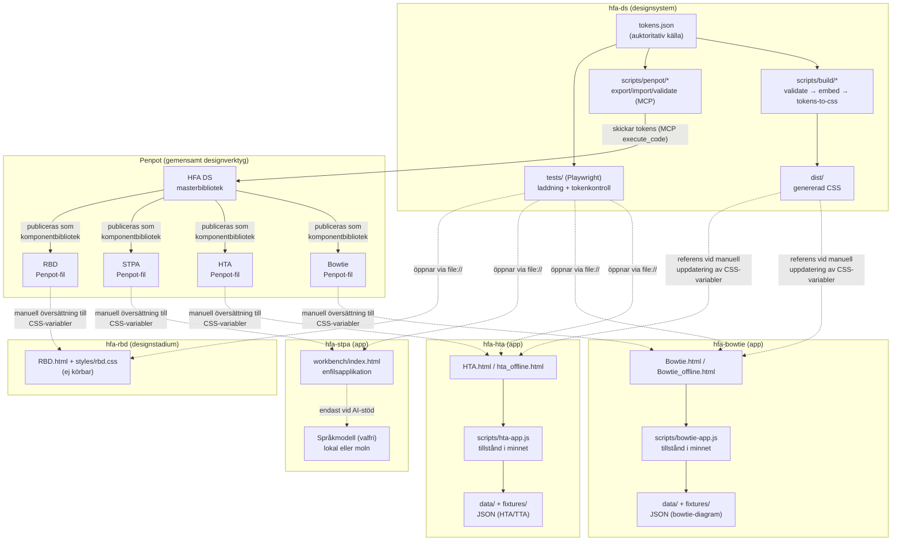
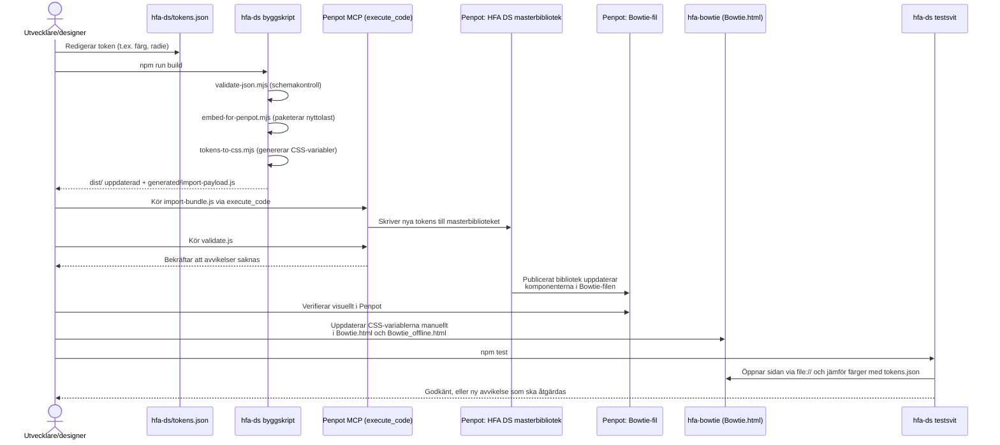
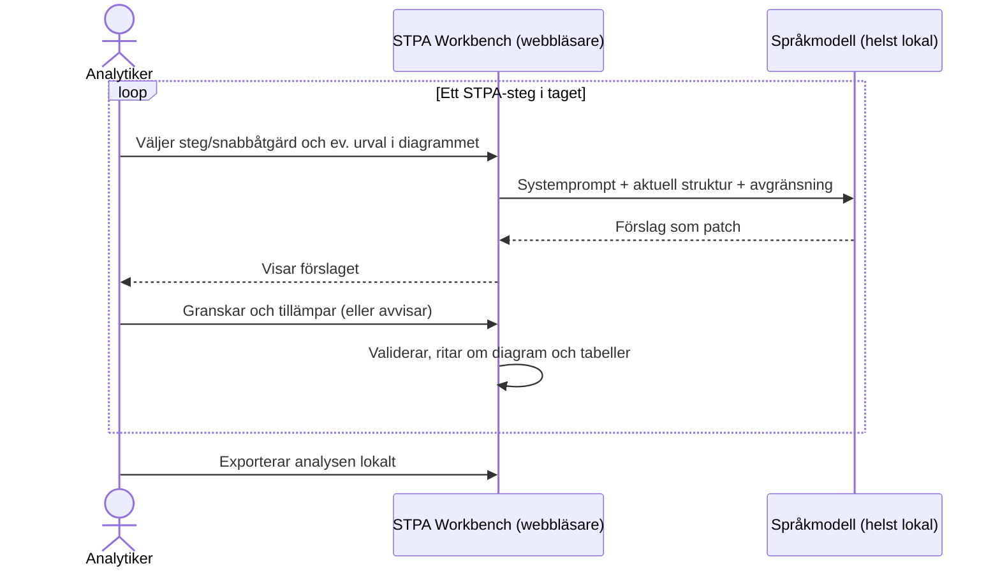

# Arkitektur: HFA-familjen (hfa-ds, hfa-hta, hfa-bowtie, hfa-stpa, hfa-rbd)

> **Status:** Samtliga verktyg och deras datamodeller är under utveckling. Filformat och datastrukturer kan ändras utan bakåtkompatibilitet, och verktygen bör därför inte användas för skarpa analyser.

## Liveversioner

| Verktyg | Liveversion | Status |
|---|---|---|
| HTA (Hierarchical Task Analysis + TTA) | [larswpettersson.github.io/hfa-hta/HTA.html](https://larswpettersson.github.io/hfa-hta/HTA.html) · [fristående offlinefil](https://larswpettersson.github.io/hfa-hta/hta_offline.html) | Körbar, under utveckling |
| Bowtie | [larswpettersson.github.io/hfa-bowtie/Bowtie.html](https://larswpettersson.github.io/hfa-bowtie/Bowtie.html) · [fristående offlinefil](https://larswpettersson.github.io/hfa-bowtie/Bowtie_offline.html) | Körbar, under utveckling |
| STPA Workbench | [larswpettersson.github.io/hfa-stpa/workbench/](https://larswpettersson.github.io/hfa-stpa/workbench/) | Körbar, under utveckling; anpassas för kumulativ, AI-stödd analys steg för steg |
| RBD (Reliability Block Diagram) | Ingen liveversion – se [repot hfa-rbd](https://github.com/larswpettersson/hfa-rbd) | Tidigt designstadium, ej körbar |

Liveversionerna publiceras via GitHub Pages. De är statiska sidor utan serverdel: den analysdata som matas in stannar i webbläsaren och lämnar den endast genom att användaren själv exporterar den (se avsnitt 1).

Visuella designbeslut (typografi, storlekar, typsnittslista) beskrivs i [docs/designprinciper.md](docs/designprinciper.md).

## 1. Grundtanke: körbarhet i isolerade miljöer och sekretess

Arkitekturen och designen utgår från två krav:

1. **Verktygen ska enkelt kunna köras i isolerade (air-gapped) miljöer och lokalt i företagsnät utan krav på programvaruinstallation.**
2. **De analyser som genomförs ska kunna hållas hemliga.**

Dessa krav styr de tekniska valen i samtliga verktygsrepon:

| Krav | Arkitekturval |
|---|---|
| Ingen installation | Varje verktyg är en eller ett fåtal statiska HTML-filer med vanilla JavaScript och CSS. Det finns inget byggsteg, ingen pakethanterare, inget ramverk och ingen server. En modern webbläsare räcker. |
| Körbarhet utan nätverk | Sidorna laddar inga externa resurser (inga CDN-skript, webbtypsnitt eller API-anrop för grundfunktionerna). HTA och Bowtie finns dessutom som en enda fristående fil (`hta_offline.html`, `Bowtie_offline.html`) med inbäddat skript; STPA Workbench är redan en enda fil. Filen kan föras över till en isolerad miljö och öppnas direkt via `file://`. |
| Sekretess | Det finns ingen serverdel och ingen databas. Analysens tillstånd hålls i webbläsarens minne och sparas genom export till en lokal JSON-fil som användaren själv förvarar. `localStorage` används endast för inställningar (tema, kolumnval, panelbredd m.m.). |
| Sekretess vid AI-stöd | AI-stödet i STPA Workbench är valfritt; editorn, diagrammet och säkerhetstabellerna fungerar utan språkmodell. Väljs en molnleverantör (Claude, Gemini) skickas strukturen till den leverantören. För sekretessbelagda analyser ska en lokalt driftad modell användas (Ollama, LM Studio, LocalAI), varvid ingen data lämnar datorn eller det lokala nätet. |

Avvägningen är medveten: avsaknaden av byggsteg och paketberoenden innebär att designtokens förs in manuellt i verktygens CSS (se avsnitt 4) och att kod inte delas mellan verktygen. I gengäld blir varje verktyg självbärande, granskningsbart och möjligt att använda utan IT-avdelningens medverkan.

## 2. Syfte och struktur

Dokumentet beskriver arkitekturen för fem relaterade repon inom Human Factors Analysis-familjen (HFA):

- **hfa-ds** – Designsystemrepot. Innehåller inga körbara applikationer utan är den auktoritativa källan för designtokens (färger, typografi, radier m.m.), byggskript och Penpot-synkverktyg som håller ett centralt Penpot-designbibliotek och konsumentprojektens Penpot-filer synkroniserade. Repot innehåller också en gemensam testsvit (Playwright) som körs mot verktygen i syskonrepona. Drivs med Node.js (ESM) utan körtidsberoenden.
- **hfa-hta** – Fristående webbverktyg för Hierarchical Task Analysis (HTA) kombinerad med Tabular Task Analysis (TTA) och HEI-fält. Huvudeditorn är `HTA.html` med logiken i `scripts/hta-app.js`. Export till JSON och till CSV (för Excel och SmartArt), ångra/gör om, kortkommandon och hjälpdialog. Datamodellen är version 2.
- **hfa-bowtie** – Fristående webbverktyg för att rita och redigera bowtie-diagram (orsaker → topphändelse → konsekvenser, med förebyggande och återställande barriärer). Logiken finns i `scripts/bowtie-app.js`. Exempeldata utgår från obehörig stoppsignalpassage (OSPA). Utskrift skalar diagrammet till en A4-sida i liggande format. Datamodellen är version 1.
- **hfa-stpa** – Stöd för System-Theoretic Process Analysis (STPA). Kärnan är **STPA Workbench** (`workbench/index.html`), en enfilsapplikation med JSON-editor för styrstrukturen, automatiskt ritat SVG-diagram, tabeller för förluster, faror, osäkra styråtgärder (UCA) och säkerhetskrav samt en analyschatt mot valfri språkmodell. Repot innehåller även `mermaid-stpa`, ett separat Mermaid-diagramtillägg för STPA-styrstrukturer (TypeScript-paket med eget byggsteg, som inte ingår i workbenchens körtid).
- **hfa-rbd** – Verktyg för Reliability Block Diagrams (RBD). Befinner sig i ett **tidigt designstadium och är inte körbart**. Nuvarande innehåll är ett gränssnittsskal i tre paneler (bibliotek, arbetsyta, analys) med statiskt exempelinnehåll, `styles/rbd.css` och ett påbörjat `scripts/rbd-app.js`.

Det gemensamma syftet är att stödja säkerhets- och human factors-analys genom separata, fokuserade editorer i webbläsaren, medan den visuella enhetligheten (färger, typsnitt, komponenternas utseende) upprätthålls via ett gemensamt designsystem i Penpot med `hfa-ds` som källa.

**Centralt arkitekturdrag:** Det finns **ingen kodkoppling vid körning** (inga npm-paket, inga delade JS-moduler, inga API-anrop) mellan repona. Kopplingen sker indirekt via:

1. Penpot som gemensamt designverktyg – `hfa-ds` äger mastertokens och synkroniserar dem till varje konsuments Penpot-fil via MCP-skript.
2. Manuellt underhållna designkonventioner – CSS-variabler i respektive HTML-fil som ska spegla `hfa-ds/tokens.json`.
3. Testsviten i `hfa-ds` – den öppnar verktygens HTML-filer från syskonrepona och kontrollerar att de laddas utan fel och att färgerna överensstämmer med `tokens.json`. Kopplingen gäller endast verifiering, inte körning.

## 3. Status per verktyg

| Verktyg | Ingång | Offlinefil | Datamodell | Persistens | Status |
|---|---|---|---|---|---|
| HTA | `HTA.html` (+ äldre `hta-editor2.html`, `hta-editor.html`) | `hta_offline.html` | JSON v2 (HTA-träd + `ttaRecords`) | JSON-export/import, CSV-export | Körbar, under utveckling |
| Bowtie | `Bowtie.html` | `Bowtie_offline.html` | JSON v1 | JSON-export/import, utskrift | Körbar, under utveckling |
| STPA Workbench | `workbench/index.html` | Samma fil (enfilsapplikation) | JSON (förluster, faror, krav, UCA, styrstruktur, aktuatorer, sensorer) | JSON-export/import, export av chatten som Markdown | Körbar, under utveckling; omställning till kumulativ analys pågår |
| RBD | `RBD.html` | – | Utkast | – | Tidigt designstadium, ej körbar |

Samtliga datamodeller är under utveckling. Exporterade filer kan behöva konverteras eller göras om när modellerna ändras.

## 4. Komponentdiagram – kommunikation mellan repon

**Kommentarer till diagrammet:**

- `hfa-ds` är den enda noden med byggkedja (validering → paketering → CSS-generering) och den enda som kommunicerar med Penpot MCP för synkronisering.
- Penpot fungerar som nav: tokens flödar in från `hfa-ds` och publiceras som komponentbibliotek till varje konsumentfil (Bowtie, HTA, STPA, RBD).
- `hfa-hta`, `hfa-bowtie` och STPA Workbench följer samma arkitekturmönster: en HTML-sida, en JavaScript-del som äger hela tillståndet i minnet och JSON-baserad import/export för persistens (ingen serverdel, ingen databas).
- Streckade linjer visar manuella eller icke-körtidsmässiga kopplingar (design → kod, test → verktyg, valfritt AI-anrop), till skillnad från de skriptdrivna MCP-flödena.

## 5. Sekvensdiagram – tokensynk från hfa-ds till ett konsumentverktyg

Detta är det primära arkitektoniska användningsfallet för designsystemet: en designer eller utvecklare ändrar en designtoken i `hfa-ds` och för ut ändringen till ett konsumentverktyg (t.ex. `hfa-bowtie`).

**Kommentar:** Eftersom verktygen saknar byggsteg och paketberoenden är kodsteget manuellt. Det är en medveten avvägning för att uppfylla kraven i avsnitt 1, inte en ofullständig integration. Testsviten fångar avvikelser som uppstår; kända avvikelser listas i `knownDrift` i `tests/shared/tokens-sync.spec.mjs`.

## 6. STPA – kumulativ analys med AI-stöd steg för steg

STPA Workbench anpassas för att genomföra analysen **kumulativt**, där varje steg i STPA bygger vidare på resultatet från föregående steg och AI stöttar analytikern i ett steg i taget. Analytikern behåller kontrollen: AI föreslår, analytikern granskar och beslutar vad som förs in i analysen.

Grundprinciperna i nuvarande version:

- **En gemensam modell:** Hela analysen (förluster, faror, säkerhetskrav, styrstruktur, UCA) hålls i en JSON-struktur som editorn, diagrammet och tabellerna läser från. Varje steg lägger till eller förfinar delar av samma modell.
- **Ändringar som patchar:** Språkmodellen ombeds returnera endast det som ändras (`"patch": true`, med `remove` för borttagningar). Analytikern väljer aktivt **Apply to editor**; ändringen kan ångras.
- **Avgränsning till ett urval:** Analytikern kan markera element i diagrammet så att frågan fokuserar på dem, medan hela strukturen skickas som kontext.
- **Fristående frågor:** Varje fråga skickas som standard med strukturen och avgränsningen, men utan tidigare chatthistorik. Det gör varje steg spårbart mot modellens aktuella tillstånd snarare än mot ett långt samtal.
- **Snabbåtgärder per analysmoment:** identifiera UCA, förlustscenarier, återkopplingslatens, brister i processmodeller, förslag till omkonfigurering och säkerhetskrav.

Omställningen till ett fullt stegvis arbetsflöde pågår, och datamodellen kommer att förändras i takt med den.

## 7. Test och kvalitetssäkring

- **Gemensam testsvit i hfa-ds:** `npm test` kör Playwright mot verktygen i syskonrepona (sökvägen kan styras med `HFA_WORKSPACE`). Sidorna öppnas via `file://`, utan utvecklingsserver, vilket motsvarar hur verktygen används i isolerade miljöer. `tests/shared/` körs mot alla verktyg i `tests/lib/tools.mjs` (felfri laddning och färger enligt `tokens.json`); verktygsspecifika tester finns i `tests/<verktyg>/` (för närvarande STPA: urval, avgränsning, konverteringar och patchar). GitHub Actions-arbetsflödet `test-tools.yml` checkar ut alla repon sida vid sida och kör sviten.
- **Röktester per verktyg:** `hfa-hta` och `hfa-bowtie` har Python-baserade röktester (`scripts/*-smoke-test.py`).
- **Tokenvalidering:** `validate-tokens.yml` validerar `tokens.json` i `hfa-ds`.
