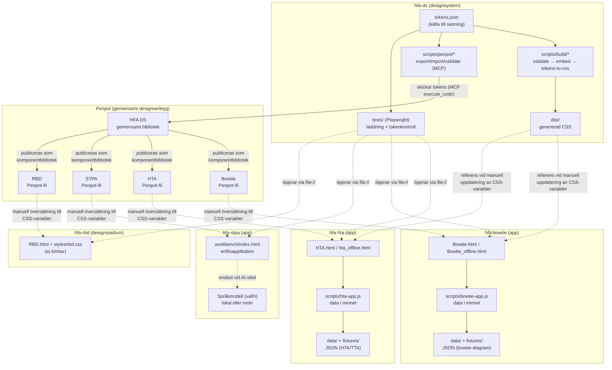
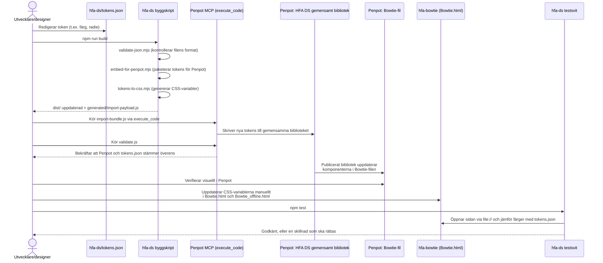
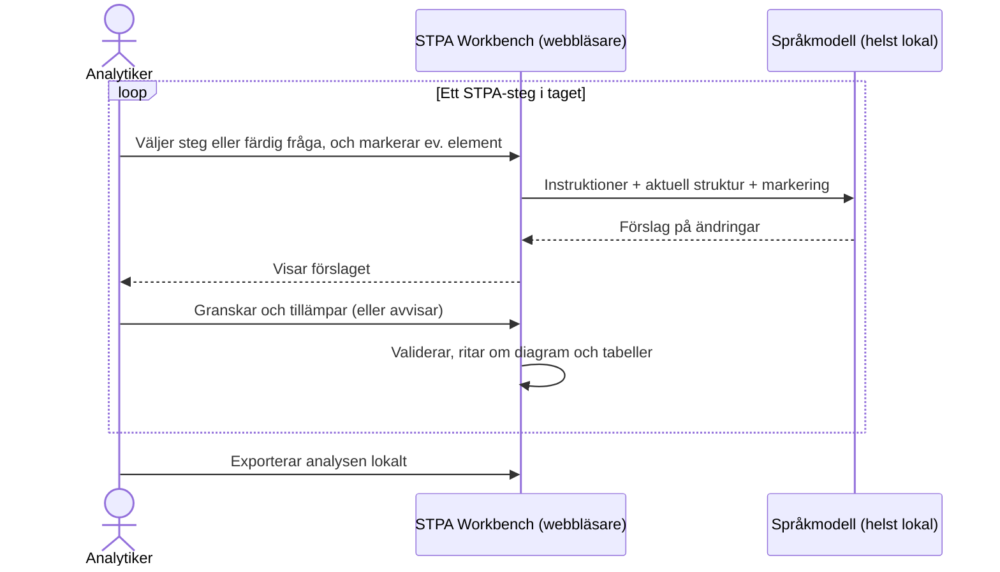

# Arkitektur: HFA-familjen (hfa-ds, hfa-hta, hfa-bowtie, hfa-stpa, hfa-rbd)

> **Status:** Samtliga verktyg och deras datamodeller är under utveckling. Filformat och datastrukturer kan ändras utan bakåtkompatibilitet, och verktygen bör därför inte användas för skarpa analyser.

## Liveversioner

| Verktyg | Liveversion | Status |
|---|---|---|
| HTA (Hierarchical Task Analysis + TTA) | [larswpettersson.github.io/hfa-hta/HTA.html](https://larswpettersson.github.io/hfa-hta/HTA.html) · [fristående offlinefil](https://larswpettersson.github.io/hfa-hta/hta_offline.html) | Körbar, under utveckling |
| Bowtie | [larswpettersson.github.io/hfa-bowtie/Bowtie.html](https://larswpettersson.github.io/hfa-bowtie/Bowtie.html) · [fristående offlinefil](https://larswpettersson.github.io/hfa-bowtie/Bowtie_offline.html) | Körbar, under utveckling |
| STPA Workbench | [larswpettersson.github.io/hfa-stpa/workbench/](https://larswpettersson.github.io/hfa-stpa/workbench/) | Körbar, under utveckling; anpassas för kumulativ, AI-stödd analys steg för steg |
| RBD (Reliability Block Diagram) | Ingen liveversion – se [repot hfa-rbd](https://github.com/larswpettersson/hfa-rbd) | Tidigt designstadium, ej körbar |

Liveversionerna publiceras via GitHub Pages. Det är vanliga webbsidor utan server bakom: det man matar in stannar i webbläsaren och lämnar den bara om användaren själv exporterar det (se avsnitt 1).

Visuella designbeslut (typografi, storlekar, typsnittslista) beskrivs i [docs/designprinciper.md](docs/designprinciper.md).

## 1. Grundtanke: körbarhet i isolerade miljöer och sekretess

Arkitekturen och designen utgår från två krav:

1. **Verktygen ska enkelt kunna köras utan att någon programvara behöver installeras, både lokalt i företagsnät och i isolerade miljöer utan internetanslutning (air-gapped).**
2. **De analyser som genomförs ska kunna hållas hemliga.**

Dessa krav styr de tekniska valen i samtliga verktygsrepon:

| Krav | Arkitekturval |
|---|---|
| Ingen installation | Varje verktyg består av en eller några få HTML-filer med vanlig JavaScript och CSS. Inget behöver byggas, installeras eller köras på en server. En modern webbläsare räcker. |
| Fungerar utan nätverk | Sidorna hämtar ingenting från internet (inga skript, typsnitt eller tjänster utifrån) för att grundfunktionerna ska fungera. HTA och Bowtie finns dessutom som en enda fristående fil (`hta_offline.html`, `Bowtie_offline.html`) med inbäddat skript; STPA Workbench är redan en enda fil. Filen kan föras över till en isolerad miljö och öppnas direkt via `file://`. |
| Sekretess | Det finns ingen server och ingen databas. Analysen finns bara i webbläsarens minne och sparas genom att användaren exporterar den till en JSON-fil på den egna datorn. `localStorage` används endast för inställningar (tema, kolumnval, panelbredd m.m.). |
| Sekretess vid AI-stöd | AI-stödet i STPA Workbench är valfritt; editorn, diagrammet och säkerhetstabellerna fungerar utan språkmodell. Väljs en molnleverantör (Claude, Gemini) skickas strukturen till den leverantören. För sekretessbelagda analyser ska en modell som körs lokalt användas (Ollama, LM Studio, LocalAI). Då lämnar ingen data datorn eller det egna nätet. |

Valet är medvetet. Eftersom verktygen saknar byggsteg och externa paket måste designtokens föras in för hand i varje verktygs CSS (se avsnitt 4), och ingen kod delas mellan verktygen. I gengäld fungerar varje verktyg helt på egen hand, koden är lätt att granska och verktygen kan användas utan hjälp från IT-avdelningen.

## 2. Syfte och struktur

Dokumentet beskriver arkitekturen för fem relaterade repon inom Human Factors Analysis-familjen (HFA):

- **hfa-ds** – Designsystemrepot. Innehåller inga körbara applikationer. Repot är källan till sanning för designtokens (färger, typografi, hörnradier m.m.) och innehåller skript som håller ett centralt designbibliotek i Penpot och verktygens egna Penpot-filer uppdaterade. Här finns också gemensamma automatiska tester (Playwright) som körs mot verktygen i de andra repona. Skripten körs med Node.js och kräver inga andra paket.
- **hfa-hta** – Fristående webbverktyg för Hierarchical Task Analysis (HTA) kombinerad med Tabular Task Analysis (TTA) och HEI-fält. Huvudeditorn är `HTA.html` med logiken i `scripts/hta-app.js`. Export till JSON och till CSV (för Excel och SmartArt), ångra/gör om, kortkommandon och hjälpdialog. Datamodellen är version 2.
- **hfa-bowtie** – Fristående webbverktyg för att rita och redigera bowtie-diagram (orsaker → topphändelse → konsekvenser, med förebyggande och återställande barriärer). Logiken finns i `scripts/bowtie-app.js`. Exempeldata utgår från obehörig stoppsignalpassage (OSPA). Utskrift skalar diagrammet till en A4-sida i liggande format. Datamodellen är version 1.
- **hfa-stpa** – Stöd för System-Theoretic Process Analysis (STPA). Kärnan är **STPA Workbench** (`workbench/index.html`), en enfilsapplikation med JSON-editor för styrstrukturen, automatiskt ritat SVG-diagram, tabeller för förluster, faror, osäkra styråtgärder (UCA) och säkerhetskrav samt en analyschatt mot valfri språkmodell. Repot innehåller även `mermaid-stpa`, ett separat Mermaid-diagramtillägg för STPA-styrstrukturer (ett separat TypeScript-paket med eget byggsteg, som workbenchen inte använder).
- **hfa-rbd** – Verktyg för Reliability Block Diagrams (RBD). Befinner sig i ett **tidigt designstadium och är inte körbart**. Nuvarande innehåll är ett gränssnittsskal i tre paneler (bibliotek, arbetsyta, analys) med statiskt exempelinnehåll, `styles/rbd.css` och ett påbörjat `scripts/rbd-app.js`.

Det gemensamma syftet är att stödja säkerhets- och human factors-analys genom separata, fokuserade editorer i webbläsaren, medan den visuella enhetligheten (färger, typsnitt, komponenternas utseende) upprätthålls via ett gemensamt designsystem i Penpot med `hfa-ds` som källa.

**Viktigt:** Verktygen **delar ingen kod** med varandra (inga npm-paket, inga gemensamma JavaScript-filer, inga anrop mellan verktygen). Det som håller ihop dem är:

1. Penpot som gemensamt designverktyg – `hfa-ds` äger designtokens och för över dem till varje verktygs Penpot-fil med MCP-skript.
2. Handskrivna CSS-variabler i varje verktygs HTML-fil, som ska ha samma värden som `hfa-ds/tokens.json`.
3. Testerna i `hfa-ds` – de öppnar verktygens HTML-filer och kontrollerar att sidorna laddas utan fel och att färgerna stämmer med `tokens.json`. Testerna påverkar inte hur verktygen fungerar.

## 3. Status per verktyg

| Verktyg | Startfil | Offlinefil | Datamodell | Hur data sparas | Status |
|---|---|---|---|---|---|
| HTA | `HTA.html` (+ äldre `hta-editor2.html`, `hta-editor.html`) | `hta_offline.html` | JSON v2 (HTA-träd + `ttaRecords`) | JSON-export/import, CSV-export | Körbar, under utveckling |
| Bowtie | `Bowtie.html` | `Bowtie_offline.html` | JSON v1 | JSON-export/import, utskrift | Körbar, under utveckling |
| STPA Workbench | `workbench/index.html` | Samma fil (enfilsapplikation) | JSON (förluster, faror, krav, UCA, styrstruktur, aktuatorer, sensorer) | JSON-export/import, export av chatten som Markdown | Körbar, under utveckling; omställning till kumulativ analys pågår |
| RBD | `RBD.html` | – | Utkast | – | Tidigt designstadium, ej körbar |

Samtliga datamodeller är under utveckling. Exporterade filer kan behöva konverteras eller göras om när modellerna ändras.

## 4. Komponentdiagram – kommunikation mellan repon

**Kommentarer till diagrammet:**

- `hfa-ds` är det enda repot med byggsteg (kontroll av tokens → paketering för Penpot → generering av CSS) och det enda som skickar ändringar till Penpot via MCP.
- Penpot är mittpunkten: tokens kommer in från `hfa-ds` och delas sedan ut som ett komponentbibliotek till varje verktygs Penpot-fil (Bowtie, HTA, STPA, RBD).
- `hfa-hta`, `hfa-bowtie` och STPA Workbench är uppbyggda på samma sätt: en HTML-sida, JavaScript som håller all data i minnet och import/export av JSON-filer för att spara arbetet (ingen server, ingen databas).
- Streckade linjer visar steg som görs för hand eller som inte behövs när verktyget används (design → kod, test → verktyg, valfritt AI-anrop). Heldragna linjer visar steg som sköts av skript.

## 5. Sekvensdiagram – så förs en ändrad token ut från hfa-ds till ett verktyg

Detta är designsystemets viktigaste flöde: en designer eller utvecklare ändrar en designtoken i `hfa-ds` och för ut ändringen till ett verktyg (här `hfa-bowtie`).

**Kommentar:** Eftersom verktygen saknar byggsteg och externa paket görs kodändringen för hand. Det är ett medvetet val för att uppfylla kraven i avsnitt 1, inte något som saknas. Testerna upptäcker om färgerna i ett verktyg skiljer sig från `tokens.json`; kända skillnader listas i `knownDrift` i `tests/shared/tokens-sync.spec.mjs`.

## 6. STPA – kumulativ analys med AI-stöd steg för steg

STPA Workbench anpassas för att genomföra analysen **kumulativt**, där varje steg i STPA bygger vidare på resultatet från föregående steg och AI stöttar analytikern i ett steg i taget. Analytikern behåller kontrollen: AI föreslår, analytikern granskar och beslutar vad som förs in i analysen.

Grundprinciperna i nuvarande version:

- **En gemensam modell:** Hela analysen (förluster, faror, säkerhetskrav, styrstruktur, UCA) finns i en och samma JSON-struktur, som editorn, diagrammet och tabellerna visar. Varje steg lägger till eller förfinar delar av samma modell.
- **AI föreslår bara ändringarna:** Språkmodellen ombeds svara med enbart det som ska läggas till, ändras eller tas bort (en så kallad patch). Ändringen förs in först när analytikern trycker på **Apply to editor**, och den kan ångras.
- **Fråga om en del av strukturen:** Analytikern kan markera element i diagrammet så att frågan gäller just dem. Hela strukturen skickas ändå med som bakgrund.
- **Varje fråga står för sig:** Som standard skickas varje fråga med strukturen och markeringen, men utan den tidigare chatten. Då bygger varje svar på hur analysen ser ut just nu och inte på ett långt samtal, vilket gör det lättare att följa hur analysen har vuxit fram.
- **Färdiga frågor för olika moment:** identifiera UCA, förlustscenarier, fördröjning i återkopplingen, brister i styrenheternas processmodeller, förslag på ändrad styrstruktur och säkerhetskrav.

Omställningen till ett fullt stegvis arbetsflöde pågår, och datamodellen kommer att förändras i takt med den.

## 7. Test och kvalitetssäkring

- **Gemensamma tester i hfa-ds:** `npm test` kör automatiska tester (Playwright) mot verktygen i de andra repona (sökvägen kan ändras med `HFA_WORKSPACE`). Sidorna öppnas direkt som filer (`file://`), utan webbserver, på samma sätt som när verktygen används i en isolerad miljö. Testerna i `tests/shared/` körs mot alla verktyg i `tests/lib/tools.mjs` och kontrollerar att sidan laddas utan fel och att färgerna stämmer med `tokens.json`. Tester för ett enskilt verktyg ligger i `tests/<verktyg>/` (i dag finns sådana för STPA: markering, frågor om en del av strukturen, omvandling till aktuator/sensor och patchar). På GitHub kör arbetsflödet `test-tools.yml` testerna med alla repon hämtade bredvid varandra.
- **Snabbtester per verktyg:** `hfa-hta` och `hfa-bowtie` har enkla tester i Python (`scripts/*-smoke-test.py`) som kontrollerar att grundfunktionerna fungerar.
- **Kontroll av tokens:** arbetsflödet `validate-tokens.yml` kontrollerar att `tokens.json` i `hfa-ds` har rätt format.
