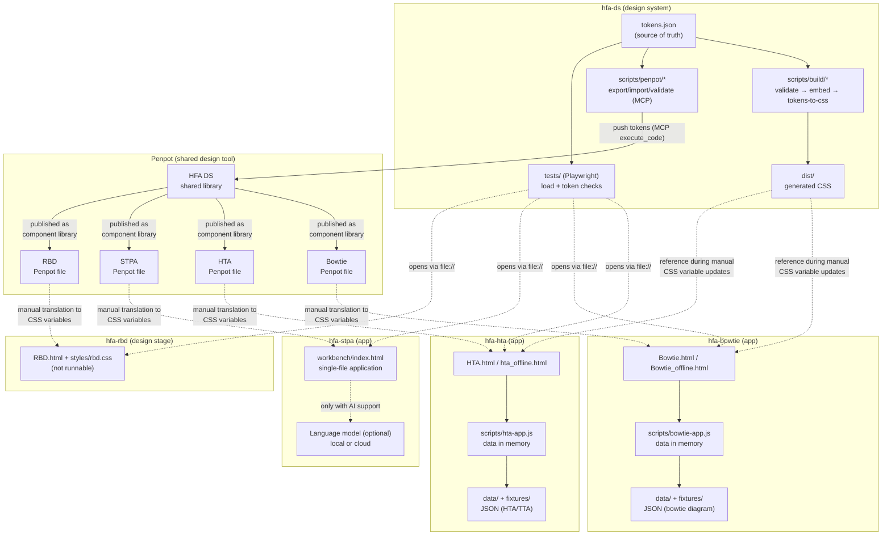
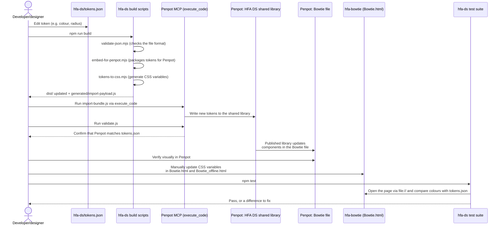
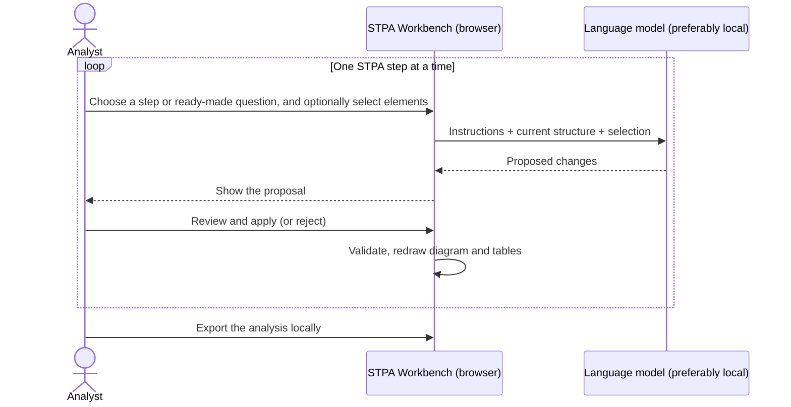

# Architecture: The HFA Family (hfa-ds, hfa-hta, hfa-bowtie, hfa-stpa, hfa-rbd)

> **Status:** All tools and their data models are under development. File formats and data structures may change without backward compatibility, and the tools should therefore not be used for production analyses.

## Live versions

| Tool | Live version | Status |
|---|---|---|
| HTA (Hierarchical Task Analysis + TTA) | [larswpettersson.github.io/hfa-hta/HTA.html](https://larswpettersson.github.io/hfa-hta/HTA.html) · [standalone offline file](https://larswpettersson.github.io/hfa-hta/hta_offline.html) | Runnable, under development |
| Bowtie | [larswpettersson.github.io/hfa-bowtie/Bowtie.html](https://larswpettersson.github.io/hfa-bowtie/Bowtie.html) · [standalone offline file](https://larswpettersson.github.io/hfa-bowtie/Bowtie_offline.html) | Runnable, under development |
| STPA Workbench | [larswpettersson.github.io/hfa-stpa/workbench/](https://larswpettersson.github.io/hfa-stpa/workbench/) | Runnable, under development; being adapted for cumulative, step-by-step AI-supported analysis |
| RBD (Reliability Block Diagram) | No live version – see the [hfa-rbd repository](https://github.com/larswpettersson/hfa-rbd) | Early design stage, not runnable |

The live versions are published through GitHub Pages. They are ordinary web pages with no server behind them: whatever is entered stays in the browser and leaves it only if the user exports it (see section 1).

Visual design decisions (typography, sizes, font stack) are documented in [docs/design-principles.md](design-principles.md).

## 1. Rationale: Operation in Isolated Environments and Confidentiality

The architecture and design are based on two requirements:

1. **The tools must be easy to run without installing any software, both locally on corporate networks and in isolated environments with no internet connection (air-gapped).**
2. **The analyses performed must be able to remain confidential.**

These requirements drive the technical choices in every tool repository:

| Requirement | Architectural choice |
|---|---|
| No installation | Each tool consists of one or a few HTML files with plain JavaScript and CSS. Nothing needs to be built, installed or run on a server. A modern web browser is enough. |
| Works without a network | The pages fetch nothing from the internet (no outside scripts, fonts or services) for their basic functions. HTA and Bowtie are also available as a single self-contained file (`hta_offline.html`, `Bowtie_offline.html`) with the script inlined; the STPA Workbench is already a single file. The file can be transferred to an isolated environment and opened directly via `file://`. |
| Confidentiality | There is no server and no database. The analysis exists only in the browser's memory and is saved when the user exports it to a JSON file on their own computer. `localStorage` is used only for preferences (theme, column selection, panel width, etc.). |
| Confidentiality with AI support | AI support in the STPA Workbench is optional; the editor, diagram and safety-case tables work without a language model. If a cloud provider (Claude, Gemini) is selected, the structure is sent to that provider, and so are images attached to a question (planned, section 7). For confidential analyses, a model running locally (Ollama, LM Studio, LocalAI) should be used. Then no data leaves the computer or the organisation's own network. Images require a local model that reads images. |

This choice is deliberate. Because the tools have no build step and use no external packages, design tokens must be copied by hand into each tool's CSS (see section 4), and no code is shared between the tools. In return, each tool works entirely on its own, its code is easy to review, and it can be used without help from the IT department.

## 2. Purpose and Structure

This document describes the architecture of five related repositories within the Human Factors Analysis (HFA) family:

- **hfa-ds** – Design system repository. Contains no runnable applications. It is the source of truth for design tokens (colours, typography, corner radii, etc.) and holds scripts that keep a central design library in Penpot and the tools' own Penpot files up to date. It also holds shared automated tests (Playwright) that run against the tools in the other repositories. The scripts run on Node.js and need no other packages.
- **hfa-hta** – Standalone web tool for Hierarchical Task Analysis (HTA) combined with Tabular Task Analysis (TTA) and HEI fields. The main editor is `HTA.html`, with its logic in `scripts/hta-app.js`. Export to JSON and to CSV (for Excel and SmartArt), undo/redo, keyboard shortcuts and a help dialog. The data model is version 2.
- **hfa-bowtie** – Standalone web tool for drawing and editing bowtie diagrams (causes → top event → consequences, with preventive and recovery barriers). The logic lives in `scripts/bowtie-app.js`. The example data is based on a signal passed at danger (SPAD, Swedish OSPA) scenario. Printing scales the diagram to a single A4 landscape page. The data model is version 1.
- **hfa-stpa** – Support for System-Theoretic Process Analysis (STPA). Its core is the **STPA Workbench** (`workbench/index.html`), a single-file application with a JSON editor for the control structure, an automatically drawn SVG diagram, tables for losses, hazards, unsafe control actions (UCAs) and safety constraints, and an analysis chat with a language model of choice. The repository also contains `mermaid-stpa`, a separate Mermaid diagram plugin for STPA control structures (a separate TypeScript package with its own build step, which the Workbench does not use).
- **hfa-rbd** – Tool for Reliability Block Diagrams (RBD). It is at an **early design stage and is not runnable**. Its current content is a three-panel interface shell (library, canvas, analysis) with static sample content, `styles/rbd.css` and an initial `scripts/rbd-app.js`.

The shared purpose is to support safety and human factors analysis through separate, focused in-browser editors, while visual consistency (colours, fonts, component appearance) is maintained through a shared design system in Penpot, sourced from `hfa-ds`.

**Important:** The tools **share no code** with each other (no npm packages, no shared JavaScript files, no calls between tools). What holds them together is:

1. Penpot as a shared design tool – `hfa-ds` owns the design tokens and copies them into each tool's Penpot file with MCP scripts.
2. Hand-written CSS variables in each tool's HTML file, which should have the same values as `hfa-ds/tokens.json`.
3. The tests in `hfa-ds` – they open the tools' HTML files and check that the pages load without errors and that their colours match `tokens.json`. The tests do not affect how the tools work.

## 3. Status by Tool

| Tool | Start file | Offline file | Data model | How data is saved | Status |
|---|---|---|---|---|---|
| HTA | `HTA.html` (+ earlier `hta-editor2.html`, `hta-editor.html`) | `hta_offline.html` | JSON v2 (HTA tree + `ttaRecords`) | JSON export/import, CSV export | Runnable, under development |
| Bowtie | `Bowtie.html` | `Bowtie_offline.html` | JSON v1 | JSON export/import, print | Runnable, under development |
| STPA Workbench | `workbench/index.html` (+ `ai-assist.js`) | `workbench/stpa_offline.html` | JSON (losses, hazards, constraints, UCAs, control structure, actuators, sensors) | JSON export/import, chat export as Markdown | Runnable, under development; transition to cumulative analysis in progress |
| RBD | `RBD.html` | – | Draft | – | Early design stage, not runnable |

All data models are under development. Exported files may need to be converted or recreated when the models change.

## 4. Component Diagram – Communication Between Repositories



**Notes on the diagram:**

- `hfa-ds` is the only repository with a build step (check tokens → package them for Penpot → generate CSS) and the only one that sends changes to Penpot through MCP.
- Penpot is the centre: tokens come in from `hfa-ds` and are then shared as a component library with each tool's Penpot file (Bowtie, HTA, STPA, RBD).
- `hfa-hta`, `hfa-bowtie` and the STPA Workbench are built the same way: one HTML page, JavaScript that keeps all data in memory, and import/export of JSON files to save the work (no server, no database).
- Dashed lines show steps done by hand or not needed when the tool is in use (design → code, test → tool, optional AI call). Solid lines show steps handled by scripts.

## 5. Sequence Diagram – How a Changed Token Reaches a Tool

This is the design system's most important flow: a designer or developer changes a design token in `hfa-ds` and carries the change through to a tool (here `hfa-bowtie`).



**Note:** Because the tools have no build step and use no external packages, the code change is made by hand. This is a deliberate choice to meet the requirements in section 1, not something missing. The tests detect when a tool's colours differ from `tokens.json`; known differences are listed in `knownDrift` in `tests/shared/tokens-sync.spec.mjs`.

## 6. STPA – Cumulative Analysis with Step-by-Step AI Support

The STPA Workbench is being adapted to carry out the analysis **cumulatively**: each STPA step builds on the results of the previous one, and AI supports the analyst one step at a time. The analyst stays in control: the AI proposes, and the analyst reviews and decides what enters the analysis.

Principles in the current version:

- **One shared model:** The whole analysis (losses, hazards, safety constraints, control structure, UCAs) lives in one JSON structure, which the editor, diagram and tables all display. Each step adds to or refines parts of the same model.
- **The AI proposes only the changes:** The language model is asked to reply with just what should be added, changed or removed (a so-called patch). The change is applied only when the analyst presses **Apply to editor**, and it can be undone.
- **Asking about part of the structure:** The analyst can select elements in the diagram so that a question is about those elements. The whole structure is still sent along as background.
- **Each question stands on its own:** By default, each question is sent with the structure and the selection but without the earlier chat. Each answer is then based on the analysis as it is now rather than on a long conversation, which makes it easier to follow how the analysis was built up.
- **Ready-made questions for each activity:** identify UCAs, loss scenarios, delays in feedback, flaws in the controllers' process models, suggested changes to the control structure, and safety constraints.



The transition to a fully step-by-step workflow is in progress, and the data model will change along with it.

## 7. AI Support: Images in the Question (Planned)

Planned support for sending an image or screenshot along with a question to the language model. The purpose and limits are described in the [design principles, section 1.6](design-principles.md). None of this is built (2026-11-03); the AI panel is described in section 10.

**In the browser.** The image comes in by pasting (the `paste` event, `clipboardData`), dragging (`drop`) or a file button. It is scaled down with `<canvas>`, keeping its proportions, to the size that is set (see below) and converted to base64. No library is needed and the offline files keep working; only the AI call itself needs a network, as before. A question then consists of text and zero or more images, and each provider translates that into its own format:

| Provider | Image format |
|---|---|
| Claude | Content block `{type: "image", source: {type: "base64", media_type, data}}` before the text block. PNG, JPEG, GIF or WebP. |
| Gemini | `parts: [{inline_data: {mime_type, data}}, {text}]`. Inline images are limited to about 20 MB per request. |
| Hugging Face and local OpenAI-compatible servers (LM Studio, LiteLLM) | `{type: "image_url", image_url: {url: "data:image/png;base64,…"}}` in the message content |
| Ollama (`/api/chat`, `/api/generate`) | `images: ["<base64>"]` on the message, without the `data:` prefix |

**Decisions:**

- **Image size: default from Gemma 4, higher in Settings.** The limit is an area in megapixels, because that is how the models count. The default is **0.65 megapixels**, which matches Gemma 4's default budget of 280 image tokens (16 px patches, pooled 3 × 3); a server on default settings scales a larger image down to that size anyway. Under **Settings** the user can choose a higher value when detail matters, for example handwriting on a whiteboard:

  | Value | Corresponds to |
  |---|---|
  | 0.65 MP (default) | Gemma 4, default budget of 280 image tokens. About 1,070 × 600 px at 16:9. |
  | 2.6 MP | Gemma 4, highest budget of 1,120 image tokens, if the server is set to it |
  | 3.75 MP | Claude from Opus 4.7, Sonnet 5 and later: at most 2,576 px on the longest side |

  The longest side is always limited to 2,576 px, because none of the models benefit from more. A higher value means more image tokens and a higher cost per question.
- **Images are not stored.** Not in `localStorage`, not in the analysis JSON and not in the Markdown export, which only notes that an image was attached.
- **Images are not sent again.** When earlier questions are included, older images are replaced with a placeholder.
- **Models without image support.** A text-only model's error is explained in the panel, and the attachment is unavailable where this can be known in advance.
- **Confidentiality.** The image takes the same path as the structure (section 1): to the cloud provider if one is selected, otherwise it stays in the organisation's network with a local model that reads images.

## 8. HTA: Customisable TTA Columns and the AI Support (Planned)

The purpose is described in the [design principles, section 1.7](design-principles.md). None of this is built (2026-11-03).

**Starting point.** The `stpa-input` branch in hfa-hta lets the analysis file define the columns in `meta.columns`: `id`, `label`, `type` (`text`, `list` or `select`), `options`, `visible` and `order`. Built-in columns can be relabelled, and other ids become custom text columns stored on each TTA row. In the tool, columns can only be shown and hidden. The AI panel on the `claude/ai-assistant` branch has the six built-in HEI fields and their meaning fixed in its system prompt, does not see custom columns, and deletes them when a suggestion is applied (`replaceState` calls `normalizeTtaRecords` without the column list).

**Data model.** Each column in `meta.columns` gets a `description` field:

```json
{ "id": "hazards", "label": "Hazards (H)", "type": "list",
  "description": "Hazard ids from the STPA analysis that the UCA can lead to, e.g. H1, H3." }
```

**Changes:**

| Part | Change |
|---|---|
| `hta-app.js`: headers and columns | Editing as in the design principles, section 1.7. A new column gets an id made from its label. Column changes go through `commit`, so they enter the undo history and are saved in `meta.columns` on export. |
| `hta-app.js`: column model | No built-in columns: `meta.columns` is used as the file gives it, and only `taskStep` is added if it is missing. The HEI columns are the default for a new analysis and for files without `meta.columns`. Each column has a `type` (`text`, `list`, or `select` with `options`); an HEI column without a type of its own gets the HEI type, so older files work as before. TTA rows keep all their fields on import, and list columns are stored as lists. |
| `hta-ai.js`: system prompt | Split into a method-independent part (HTA, the scribe role, the patch format) and a column part built from `meta.columns` with label, description, type and options. |
| `hta-ai.js`: context and patch | The AI gets every visible column and its values, custom ones included. A patch is checked against the columns: unknown fields are rejected, and for `select` the value must be one of the options. |
| `hta-app.js`: `replaceState` | Passes the column list to `normalizeTtaRecords`, so custom columns are not deleted. |
| `data/`: templates | Templates as JSON, for example HEI (HRA) and Input to STPA. A template fills in `meta.columns` and the column descriptions. |

**Order:**

1. Merge `stpa-input` into `main` in hfa-hta.
2. The `description` field and editing of headers and columns.
3. The AI adapter reads the columns, and `replaceState` is fixed.
4. Templates.

An AI suggestion of new columns (a patch with `columns`) waits until suggestions can be shown as Before/After/Difference (design principles, 1.3).

## 9. Testing and Quality Assurance

- **Shared tests in hfa-ds:** `npm test` runs automated tests (Playwright) against the tools in the other repositories (the location can be changed with `HFA_WORKSPACE`). Pages are opened directly as files (`file://`), without a web server, just as when the tools are used in an isolated environment. The tests in `tests/shared/` run against every tool in `tests/lib/tools.mjs` and check that the page loads without errors and that its colours match `tokens.json`. Tests for a single tool live in `tests/<tool>/` (today there are such tests for STPA: selection, questions about part of the structure, conversion to actuator/sensor, and patches). On GitHub, the `test-tools.yml` workflow runs the tests with all repositories fetched side by side.
- **Quick tests per tool:** `hfa-hta` and `hfa-bowtie` have simple Python tests (`scripts/*-smoke-test.py`) that check that the basic functions work.
- **Token check:** the `validate-tokens.yml` workflow checks that `tokens.json` in `hfa-ds` has the correct format.

## 10. The AI Panel: One Shared Component with Per-Tool Configuration

The AI panel is a single file, `ai-assist.js`, used by HTA, Bowtie and STPA Workbench. The panel does everything that should be the same in every tool: the providers (Claude, Gemini, Hugging Face and a local model), the model picker, streaming, Markdown rendering, foldable answers, export to Markdown, the icon button that shows and hides the panel (design principle 4.7), the Enter rule (4.6) and the state without a provider.

**The source is in hfa-ds**, in `scripts/ai-panel/ai-assist.js`. Each tool holds a copy: `hfa-hta/scripts/ai-assist.js`, `hfa-bowtie/scripts/ai-assist.js` and `hfa-stpa/workbench/ai-assist.js`. The copies are never edited by hand. A change is made in the source, and `npm run sync:ai-panel` in hfa-ds copies the file into the tools (`npm run check:ai-panel` only compares). The test `tests/shared/ai-panel-copies.spec.mjs` fails if a copy differs from the source. A new tool is added to the `TARGETS` list in `scripts/ai-panel/sync.mjs`.

**What differs between the tools is configuration, not code.** Each tool mounts the panel with `HFAAssist.mount({…})` when it is built up, and that call sets:

- `systemPrompt`: the default system prompt. It is the text shown at the bottom of *Settings…*. The user can edit it for that tool and reset it to the tool's default. It is saved per tool (`id` gives the key prefix), so HTA, Bowtie and STPA each have their own prompt even though the provider settings are shared.
- `schemaPrompt`: text appended after the system prompt that describes the tool's data model and what a change proposal (a patch) looks like. It can be a function built for every question. It sits outside the editable prompt, so saved custom prompts still get schema changes.
- `title`, `subject` (the topic in the question field's hint), `welcome`, `quickActions` and `exportName`.
- `getContext` (the analysis sent with every question, headed by `contextLabel`) and `getScope` (the selection).
- `inspect`, `apply`, `snapshot` and `restore`: which JSON blocks in an answer can be applied, how they are applied and how they are reverted.
- `toolbar` and `buttonClass`: where the icon button sits when the panel is hidden and how it should look in the tool's toolbar.

A future tool therefore gets the same panel by loading `ai-assist.js` and calling `mount` with its own configuration. The provider settings (keys, models, address) are shared by the tools under `hfa-ai:providers` when they run from the same origin.

**Offline files.** The tools must still work as one file. `npm run build:offline -- <tool.html> <output.html>` (the script `scripts/build/inline-offline.mjs`) inlines every `<script src="…"></script>` that stands on a line of its own. HTA and Bowtie have their offline files (`hta_offline.html`, `Bowtie_offline.html`) built this way, and STPA has `workbench/stpa_offline.html`. Rebuild when `ai-assist.js` or the tool's HTML changes.

STPA Workbench no longer has a provider or MCP layer of its own; it was removed when the tool moved to the shared panel.
